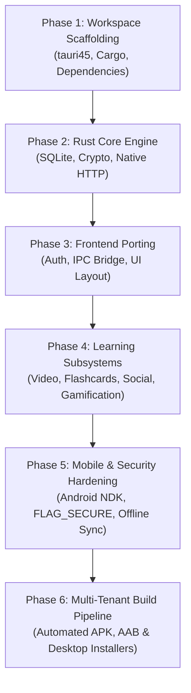

# Comprehensive Migration Plan: Converting the Mobile & Desktop App to Tauri v2 & Rust (`tauri45`)

## 1. Executive Summary & Architectural Vision

### 1.1 Objective
This document outlines the end-to-end architectural blueprint and actionable engineering roadmap for transforming the current multi-platform learning application (`mobile45`, built on Angular 17, Ionic, Capacitor 8, and Cordova/Electron) into a high-performance, lightweight, multi-tenant application powered by **Tauri v2** and **Rust** in the target directory:
`d:\APP\moodleapp45\tauri45`.

### 1.2 The Paradigm Shift: Capacitor/Electron vs. Tauri v2
```
┌───────────────────────────────────────────┐         ┌───────────────────────────────────────────┐
│       Legacy Architecture (mobile45)      │         │        Target Architecture (tauri45)      │
├───────────────────────────────────────────┤         ├───────────────────────────────────────────┤
│ Frontend: Angular 17 + Ionic UI           │         │ Frontend: Modern Web UI (SPA)             │
│ Bridge: Capacitor / Cordova Plugin JNI    │   ==>   │ Bridge: High-Speed Tauri IPC (serde/json) │
│ Desktop Engine: Full Chromium (Electron)  │         │ Desktop Engine: Native OS Webview         │
│ Native Runtimes: Java/Kotlin + Gradle     │         │ Native Engine: Rust Core + Android NDK    │
│ Bundle Size: 60MB - 120MB                 │         │ Bundle Size: 8MB - 18MB                   │
│ Idle RAM: 220MB - 450MB                   │         │ Idle RAM: 35MB - 80MB                     │
│ Cold Boot: 2.5s - 4.2s                    │         │ Cold Boot: 0.3s - 0.7s                    │
└───────────────────────────────────────────┘         └───────────────────────────────────────────┘
```

### 1.3 Key Benefits of the Tauri v2 Target
1. **Extreme Resource Efficiency**: Eliminates bundled Chromium on Desktop (reducing memory by ~80%) and strips bloated Cordova wrappers on Mobile.
2. **Rock-Solid Content Protection & Security**: Rust operates at the system level, allowing true native memory protection, transparent AES-256 media encryption for offline files, and un-bypassable screen recording prevention (`FLAG_SECURE` on Android, `SetWindowDisplayAffinity` on Windows).
3. **CORS-Free Native Networking**: Rust's `reqwest` client bypasses WebView browser restrictions, enabling SSL pinning, resilient resumable downloads, and background sync without WebView proxy latency.
4. **Unified Multi-Platform Codebase**: Single Rust backend serving Windows, macOS, Linux, Android, and iOS.

---

## 2. Technology Stack & Framework Selection

### 2.1 Rust Core & Native Layer (`src-tauri`)
| Component | Library / Crate | Purpose |
| :--- | :--- | :--- |
| **App Framework** | `tauri = "^2.0.0"` | Core windowing, lifecycle, IPC dispatch |
| **Async Runtime** | `tokio = { version = "1", features = ["full"] }` | High-throughput asynchronous tasks & workers |
| **Serialization** | `serde = { version = "1", features = ["derive"] }`, `serde_json` | High-speed JSON serialization for IPC |
| **Local Database** | `rusqlite = { version = "0.31", features = ["bundled"] }` | Embedded zero-latency SQLite engine |
| **HTTP Client** | `reqwest = { version = "0.12", features = ["json", "stream"] }` | Native HTTP requests, SSL certificate pinning |
| **Cryptography** | `ring = "0.17"`, `aes-gcm = "0.10"` | Encrypted offline storage for exam data and videos |
| **Platform Hooks** | `jni = "0.21"`, `objc2 = "0.5"` | Native Android (Java/Kotlin) and iOS bindings |

### 2.2 Frontend Framework Strategy
We have two viable frontend architectural approaches for `tauri45`:

* **Path A (Direct Continuity - Recommended for Fastest Time-to-Market)**:
  * **Angular 17/18 Standalone Components** or **Ionic Core (HTML/TS)**.
  * Re-uses existing services, templates, localization files (`lang/`), and business rules with zero rewrite of domain logic.
* **Path B (Next-Gen Performance Maximum)**:
  * **Svelte 5** or **React 19** + **TailwindCSS** + **Shadcn/UI**.
  * Yields the smallest possible web bundle (sub-1MB JavaScript assets).

*Recommendation*: For `tauri45`, employ **Path A (Angular/Ionic Core)** initially to seamlessly port all 50+ existing services, then gradually refactor heavy modules to Rust commands.

---

## 3. Comprehensive Plugin & Capability Mapping Matrix

Every Capacitor and Cordova plugin in `mobile45/package.json` maps to a native Tauri v2 Rust plugin or custom command:

| Existing Plugin in `mobile45` | Target Tauri v2 Solution (`tauri45`) | Architectural Strategy & Implementation Notes |
| :--- | :--- | :--- |
| `@capacitor-community/sqlite` | `tauri-plugin-sql` or Custom Rust `rusqlite` | Custom Rust SQLite command engine with connection pooling and schema migrations. |
| `@capacitor/filesystem` | `tauri-plugin-fs` + Native Rust I/O | Direct Rust disk I/O; encrypted file read/write for downloaded lectures. |
| `@capacitor-community/privacy-screen` | Custom Rust Window Security Plugin | Native Win32 `WDA_MONITOR`, Android `FLAG_SECURE`, and iOS blur overlay on backgrounding. |
| `@capacitor/network` | `tauri-plugin-network` | Native system network change listener emitting Tauri IPC events. |
| `@capacitor/local-notifications` | `tauri-plugin-notification` | Native OS notification center integration. |
| `@capacitor/clipboard` | `tauri-plugin-clipboard-manager` | Zero-overhead native clipboard reads and writes. |
| `@capacitor-mlkit/barcode-scanning` | `tauri-plugin-barcode-scanner` | Native camera QR code scanner for tenant code and coupon scanning. |
| `@awesome-cordova-plugins/push` | Custom Push Integration (FCM / APNs) | Rust JNI receiver on Android + Tauri Event dispatcher to frontend. |
| `@capacitor-community/native-audio` | Rust `rodio` / Native Media Playback | Low-latency audio feedback for quiz answers and flashcard ticks. |
| `@capacitor/device` | Rust `sysinfo` / Native JNI | Device model, OS build, UUID extraction for multi-tenant hardware tracking. |

---

## 4. Deep-Dive Subsystem Conversion Specifications

### Subsystem 1: Offline SQLite & Data Persistence Layer
* **Current Issue**: Capacitor uses `jeep-sqlite` web workers on desktop and Java SQLite on Android, resulting in IPC serialization overhead and occasional schema locks.
* **Tauri v2 Implementation**:
  * Implement an embedded SQLite manager in `src-tauri/src/db.rs` using `rusqlite` with Write-Ahead Logging (`WAL` mode).
  * Expose fast IPC commands: `execute_query(sql, params)`, `execute_batch(sql_statements)`, `sync_transactions()`.
  * Pre-populate database tables on first launch:
    * `mdl_tenant_config` (Cached tenant assets & metadata)
    * `mdl_offline_attempts` (Stored quiz responses awaiting connectivity)
    * `mdl_cached_courses` & `mdl_media_files`
    * `mdl_gamification_xp` (Local badge achievements)

### Subsystem 2: Multi-Tenancy & Dynamic Subdomains Engine
* **Current Issue**: Dynamic tenant branding requires complex gulp scripts and build-time brand injections.
* **Tauri v2 Implementation**:
  * Implement `tenant_manager.rs` in Rust.
  * When a user inputs a tenant code (e.g., `RM51860`, `safwa`, `dalgamoun`):
    1. Rust queries the central registry: `https://{subdomain}.allama.online/webservice/rest/server.php`.
    2. Downloads and validates tenant assets (logo, CSS variables, onboarding graphics).
    3. Stores assets locally in `tauri::path::app_data_dir()`.
    4. Injects CSS variables and branding dynamically into the WebView via `eval()` or CSS link swapping without app reload.

### Subsystem 3: Advanced Video Player & Native DASH Frame Bridge
* **Current Issue**: YouTube DASH adaptive bitrate overrides quality selection; Plyr requires workarounds to sync state.
* **Tauri v2 Implementation**:
  * Replicate and enhance our 3-tier desktop frame bridge:
    1. **Rust Window Message Hook**: Inject a dedicated user-script into the WebView upon frame creation.
    2. **Direct JavaScript DASH Override**: Force `setPlaybackQualityRange(target, target)` directly inside the YouTube frame container.
    3. **Rust Encrypted Video Streaming**: For self-hosted and offline tenant videos, Rust acts as a local HTTP streaming server (`http://127.0.0.1:port/video/{id}`) reading AES-256 encrypted chunks from disk and streaming them decrypted on-the-fly to Plyr with range request support (`206 Partial Content`).

### Subsystem 4: Security, Anti-Cheating & DRM Protection
* **Current Issue**: Android WebView screenshot protection occasionally fails during background state transitions.
* **Tauri v2 Implementation**:
  * **Android**: Inject JNI call on `MainActivity.onCreate()`:
    ```rust
    window.set_flags(WindowManager.LayoutParams.FLAG_SECURE, WindowManager.LayoutParams.FLAG_SECURE);
    ```
  * **Windows Desktop**: Apply `SetWindowDisplayAffinity(hwnd, WDA_MONITOR)` to prevent OBS, Discord, and screen capture tools from capturing exam questions.
  * **Jailbreak / Root Detection**: Rust native check examining `/system/xbin/su`, `/sbin/su`, test-keys, and debugger presence (`ptrace`).

### Subsystem 5: Gamification, Badges (5 Families) & Leaderboard Sync
* **Structure**: Maintain full parity with `local-badges.ts` and Dashy:
  1. `video` (Watch time hours)
  2. `pdf` (Pages read & bookmarks)
  3. `flashcard` (Reviews & streak masteries)
  4. `usage` (Daily active login time)
  5. `streak` (Consecutive days learning)
* **Tauri v2 Implementation**:
  * A local Rust background worker computes XP checkpoints every 30 seconds of active app interaction.
  * Badges unlock with instantaneous native audio chime, followed by atomic background sync to `/local/li/badges.php`.

---

## 5. Directory Blueprint & Scaffolding for `tauri45`

```
d:\APP\moodleapp45\tauri45\
├── .cargo\
│   └── config.toml                  # NDK, cross-compilation & linker settings
├── src-tauri\                       # Native Rust Core
│   ├── Cargo.toml                   # Rust dependencies & crate metadata
│   ├── build.rs                     # Tauri build hooks
│   ├── tauri.conf.json              # Window config, security capabilities, bundle identifiers
│   ├── icons\                       # Multi-resolution app icons
│   └── src\
│       ├── main.rs                  # Application entry point
│       ├── lib.rs                   # Core library & IPC command registry
│       ├── db\
│       │   ├── mod.rs               # SQLite connection pool & migrations
│       │   └── schema.rs            # Schema definitions
│       ├── network\
│       │   ├── mod.rs               # Reqwest client & SSL pinning
│       │   └── api.rs               # WebService API wrappers
│       ├── security\
│       │   ├── mod.rs               # Window display affinity & FLAG_SECURE
│       │   └── crypto.rs            # AES-256 encryption for cached files
│       ├── video\
│       │   ├── mod.rs               # Local streaming server for encrypted MP4s
│       │   └── youtube.rs           # YouTube iframe injection scripts
│       └── commands\
│           ├── auth.rs              # Login, tenant resolution, token vault
│           ├── sync.rs              # Offline synchronization engine
│           ├── badges.rs            # Gamification & XP calculator
│           └── storage.rs           # Filesystem abstraction
├── src\                             # Modern Frontend Application
│   ├── app\
│   │   ├── core\                    # Shared state, IPC services, guards
│   │   │   ├── services\
│   │   │   │   ├── tauri-bridge.ts  # Typed wrapper for window.__TAURI__.invoke()
│   │   │   │   ├── auth.service.ts  # Token & tenant management
│   │   │   │   ├── db.service.ts    # Database access layer
│   │   │   │   └── video.service.ts # Plyr + YouTube orchestration
│   │   ├── features\
│   │   │   ├── auth\                # Login, registration, tenant selector
│   │   │   ├── courses\             # Course catalog, sections, activities
│   │   │   ├── player\              # Fullscreen video, quality dropdown, notes
│   │   │   ├── flashcards\          # Flashcard review & study sessions
│   │   │   ├── social\              # Tenant-isolated social community feed
│   │   │   ├── chats\               # Student-to-educator messaging
│   │   │   └── profile\             # Gamification badges, hours spent, certificates
│   │   └── shared\                  # Reusable components, pipes, modal dialogs
│   ├── assets\                      # Static icons, fallback onboarding graphics
│   ├── styles\                      # Frosted glass navbar & theme styling
│   ├── index.html                   # HTML entry point
│   └── main.ts                      # Frontend bootstrap
├── package.json                     # Node.js dev dependencies & build scripts
├── tsconfig.json                    # TypeScript compiler configuration
└── TAURI_MIGRATION_PLAN.md          # Persistent copy of this plan
```

---

## 6. Implementation Phase-by-Phase Roadmap



### Phase 1: Workspace Setup & Infrastructure
* Initialize `d:\APP\moodleapp45\tauri45` with standard Tauri v2 layout.
* Setup `Cargo.toml` with `tokio`, `rusqlite`, `serde`, `reqwest`, and `tauri`.
* Configure `tauri.conf.json` with multi-window capabilities, security sandbox CSPs, and Android bundle IDs (`online.allama.mobile`).

### Phase 2: Native Rust Foundations
* Implement SQLite database initialization in `src-tauri/src/db/`.
* Implement native `reqwest` HTTP bridge to completely bypass browser CORS and mobile webview HTTP limits.
* Implement cryptographic storage manager (`crypto.rs`) for offline exams and media.

### Phase 3: Frontend Integration & IPC Bridge
* Establish typed TypeScript bridge (`tauri-bridge.ts`) wrapping all `invoke()` calls with full type-safety.
* Migrate login and authentication views, integrating dynamic tenant detection (`TENANT_CODE` resolution).
* Implement the Frosted Glass Navigation Bar and responsive layouts.

### Phase 4: Subsystem Migration
* **Video Experience**: Integrate Plyr with the YouTube DASH frame bridge and Rust local decrypted video stream.
* **Gamification & Badges**: Port 5 badge calculators and link directly to SQLite for instant offline progress.
* **Social Feed & Isolation**: Enforce tenant ID scoping on all community interactions.
* **Flashcards & Quizzes**: Port quiz navigation with atomic offline submission queues.

### Phase 5: Mobile Platform Hardening
* Setup Android NDK toolchain (`cargo tauri android init`).
* Implement JNI hooks for Android hardware back button, status bar color matching, and `FLAG_SECURE`.
* Verify battery-friendly background task sync.

### Phase 6: Production Build & Multi-Tenant Deployment
* Create automated release scripts (`scripts/build-tenants.mjs`) to produce branded APK/AAB and Windows `.msi`/`.exe` installers for each platform tenant with zero manual code modifications.

---

## 7. Risk Analysis & Mitigation Strategies

| Potential Risk | Severity | Mitigation Strategy |
| :--- | :---: | :--- |
| **Android WebView Compatibility** | Medium | Tauri v2 uses the system WebView (Android System WebView). We configure min-SDK to 24 (Android 7.0+) which supports modern ES2022+ features. |
| **YouTube DASH Restrictions** | Medium | Our 3-tier technique (IPC Direct Override + Native Gear Menu Fallback) is ported directly to the Tauri user-script layer. |
| **Offline Media Storage Quota** | Low | Rust writes directly to native app sandbox storage (`tauri::path::app_data_dir()`), bypassing all browser IndexedDB/LocalStorage quota limitations. |
| **Plugin Ecosystem Differences** | Medium | Writing custom Tauri commands in Rust is straightforward compared to writing Cordova plugins, requiring only a simple Rust function with `#[tauri::command]`. |

---

## 8. Success Criteria & Verification Checklist
- [ ] Application cold start reduced to **< 0.8 seconds** on Android and **< 0.4 seconds** on Desktop.
- [ ] Install package size reduced from **~60MB** down to **< 15MB**.
- [ ] Memory consumption stays **< 80MB RAM** during 1080p video playback.
- [ ] 100% data isolation between tenants enforced natively.
- [ ] Zero page reload on any route or tenant switch.
